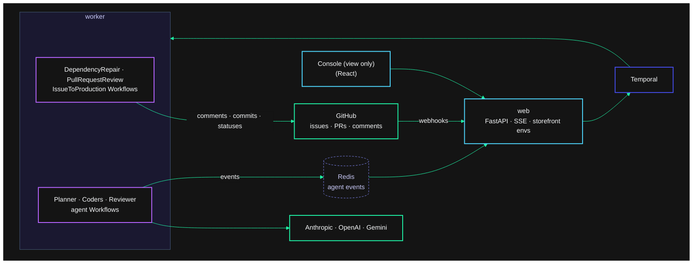

# Agentic SDLC on Temporal

AI agents work in a real GitHub repo, and people work with them there. A Dependabot-style bump breaks the build: an agent works out why from the failures and the dependency's changelog, fixes the code on the bump branch and rewrites the PR to explain it. A person opens a PR: an agent reviews it inline behind a required check and pushes fixes when asked. An issue labeled `agent`: agents plan it, code it in parallel, review it and ship it through a canary. Temporal runs the process around them and keeps that work alive through worker crashes, days-long waits for people, rate limits and a bad canary.

Everything is driven by GitHub's webhooks and everyone talks to the agents on GitHub. The console is a window onto what the agents are doing.

- **Agents are Workflows.** Each planner, coder and reviewer is a [temporal-agent-harness](https://github.com/temporal-sa/temporal-agent-harness) agent running [Pydantic AI](https://ai.pydantic.dev/durable_execution/temporal/) on Anthropic, OpenAI or Gemini. Every model call and tool call is an [Activity](https://docs.temporal.io/activities), so a crash loses nothing that already finished.
- **Each scenario is one Workflow** that reads top to bottom as its lifecycle: [`DependencyRepair`](agentic_sdlc/pipeline/dependency.py), [`PullRequestReview`](agentic_sdlc/pipeline/review.py) and [`IssueToProduction`](agentic_sdlc/pipeline/workflow.py), sharing [`pipeline/base.py`](agentic_sdlc/pipeline/base.py). They start agents as [Child Workflows](https://docs.temporal.io/child-workflows), with one coder per subtask in parallel.
- **GitHub drives it, with no polling.** The web server verifies each webhook's signature, starts a run for a new issue or PR, and delivers every comment to the runs watching that issue or PR as a [Signal](https://docs.temporal.io/develop/python/workflows/message-passing), found with a Visibility query on a search attribute. A run waiting for people costs nothing.
- **People steer the agents on GitHub.** `/approve`, `/merge`, `/ship`, `/stop` and `/continue` decide gates. Any other comment is conversation: an answer to the planner, steering for coders at work, feedback fixed on the PR branch and re-reviewed, or a new requirement that sends the run back to planning.
- **The agent gates PRs** with a required commit status, `agentic-sdlc/agent-review`, pending until it's done.
- **Retries come from [Retry Policies](https://docs.temporal.io/encyclopedia/retry-policies),** including GitHub's `Retry-After`. A per-run budget is enforced by the Workflow before every agent turn.
- **The canary bakes on a durable timer.** If its checks fail, a saga stops the traffic, reverts the merge through a PR and reopens the issue.
- **[Worker Versioning](https://docs.temporal.io/worker-versioning)** with Pinned Workflows lets the pipeline change (v2 adds a security-review agent) while runs are in flight.
- **Agent events stream through Redis** with the harness's `RedisEventStream`, so live streaming costs no Actions. The console reads run progress with Describe.

## How it works



All of it happens on [temporal-sa/agentic-sdlc-storefront](https://github.com/temporal-sa/agentic-sdlc-storefront), a small storefront whose `main` stays locked: the agents get PRs ready to merge, and nothing merges into the shared repo.

**Dependency repair.** The repo's *Dependency bump* Action opens a Dependabot-style PR that upgrades [orbit-money](https://github.com/temporal-sa/orbit-money) from 1.0 to 2.0, which has breaking changes.

1. The agent's required check goes pending. The run tests the bump branch; if it passes, the check goes green and that's it.
2. If it fails, a coding agent diagnoses it from the test output, the diff and the package's changelog, and posts the diagnosis.
3. It fixes our code on the bump branch until the tests pass, and the PR description is rewritten: the bump, what changed in the package, what broke, what we changed and why, how to verify.
4. A reviewer agent on another model family reviews the combined change; the check goes green ("ready to merge") or says what's wrong.
5. The run listens to the PR: a comment goes to a coder, who pushes, and the reviewer looks again. It ends when the PR closes, or after a quiet day.

**PR review.** Someone opens a PR. The check goes pending, the reviewer posts a review with inline comments, the check passes or fails, and a reply asking for a change sends a coder to push it to the PR branch (PRs from forks get suggestions instead).

**Issue to production.** Someone opens an issue labeled `agent`.

1. The planner asks on the issue about anything it leaves open, then posts a plan of one to three subtasks. `/approve` starts the build; any other reply revises the plan.
2. One coding agent per subtask works on its own branch, and every edit is committed and pushed, so the branch is the durable workspace. A comment on the issue while they work becomes their next instruction. The pipeline runs the tests itself and sends failures back.
3. Branches merge into a PR against the run's own base branch. A reviewer agent reviews it, then people comment on the PR: the planner triages each comment as feedback (a coder fixes it, the reviewer looks again) or a scope change (the PR closes and the run re-plans). On auto merge it merges after a quiet minute; supervised waits for `/merge`.
4. It deploys to staging, checks it and asks on the issue: `/ship` or `/stop <reason>`. The canary takes 20% of production traffic for 90 seconds of checks, then it's promoted, or rolled back by a saga that also reverts the merge and reopens the issue.

The storefront environments are served by the web server straight from the commits GitHub holds, so agent-written code only runs in the visitor's browser and in the worker's sandboxed test run.

## Run it

Prerequisites: [uv](https://docs.astral.sh/uv/), Node 20+, the [Temporal CLI](https://docs.temporal.io/cli), Redis (`brew install redis`), and a `.env.local` with at least one LLM key plus the GitHub token:

```
ANTHROPIC_API_KEY=...
OPENAI_API_KEY=...
GEMINI_API_KEY=...
GITHUB_TOKEN=github_pat_...        # fine-grained PAT for the storefront repo
GITHUB_SANDBOX_REPO=temporal-sa/agentic-sdlc-storefront
```

```bash
uv sync && npm --prefix web ci && npm --prefix web run build
uv run python scripts/dev.py
```

Open the console at http://localhost:8000 and the Temporal UI at http://localhost:8233. To present it, follow [RUNBOOK.md](RUNBOOK.md).

`dev.py` relays the repo's webhooks to your laptop with `gh webhook forward` (it installs the extension; your gh login needs `admin:repo_hook`). Your laptop is its own copy of the demo: task queue `local-<your GitHub login>`, acting only on issues and PRs labeled `agentic-sdlc:local-<login>`, which "Start a scenario" adds. GitHub allows one forwarder per repo at a time.

| Command | What it does |
|---|---|
| `uv run python scripts/dev.py` | Temporal, Redis, the web server and a worker per pipeline version (v1, v2), with the console's kill and start controls |
| `uv run python scripts/drive_run.py dependency` | A scenario from the command line (`dependency`, `review` or `issue`), answering on GitHub with `gh` |
| `uv run python scripts/drive_conversation.py` | Rehearses every steering beat of the issue flow on GitHub |
| `scripts/setup-github.sh [--webhook-url URL]` | Labels, rulesets, the template on `main`, the sample PR branch, and the hosted webhook |
| `uv run pytest` | Pipeline tests against a local dev server, with fake agents |
| `docker compose up --build` | The catalog's process layout on one machine |
| `npm --prefix web run dev` | The console with hot reload on :5173, proxied to the API on :8000 |

### Tuning knobs

| Variable | Default | Effect |
|---|---|---|
| `RUN_BUDGET_USD` | `3.00` | Default per-run budget; the run pauses at a gate when estimated spend reaches it |
| `MAX_ACTIVE_GITHUB_RUNS` | `3` | Runs one copy of the demo has in progress; past it, the agent says so on GitHub and starts nothing |
| `GITHUB_WEBHOOK_SECRET` | (required) | Verifies GitHub's webhook signatures; `dev.py` makes one per session |
| `AGENT_MODELS_<PROVIDER>` | see `agents/registry.py` | Comma-separated allowlist per provider; first is the default |
| `ENABLED_PROVIDERS` | `anthropic,openai,google` | Providers the console offers |
| `PIPELINE_VERSION` | `v1` | Set per worker with `TEMPORAL_WORKER_BUILD_ID`; `v2` adds the security-review agent |

## Notes

- **Harness fork.** This uses the temporal-sa fork of temporal-agent-harness, pinned to commit `f12f194` on its `pluggable-event-streams` branch, for `RedisEventStream`. `agents/harness_ext.py` holds the few workarounds it needs for Pydantic AI 2.53, each commented with why.
- **Both pipeline versions run all the time,** one worker each, and the console makes one current through Temporal's Worker Deployment API (the pizza Worker Versioning demo's approach), so the rollout works live in the catalog. The v2 pipeline is the same code with `PIPELINE_VERSION=v2`. Each Worker Deployment Version always runs with one value, so a Pinned run replays against the path it started on. In a real project v2 would be the next commit.
- **Agents never wait for tool approvals.** Every tool call is auto-approved, since nobody could approve one from GitHub; people gate the plan, the merge and the release instead.
- **Agent-written tests** run in the worker with a clean environment and a timeout, not in an isolated sandbox. See [docs/catalog.md](docs/catalog.md).
- **Costs are estimates** from token counts and the genai-prices database that ships with Pydantic AI, not provider bills.
- **The GitHub token expires on 2027-10-22.** Rotation is in the RUNBOOK.
- The story, the research and every source are in [docs/story.md](docs/story.md). Catalog decisions are in [docs/catalog.md](docs/catalog.md).
