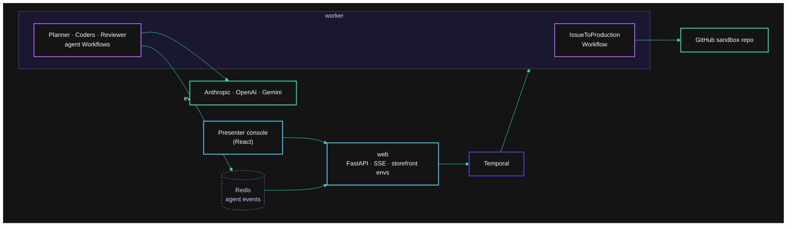

# Agentic SDLC on Temporal

AI agents take a real GitHub issue to a canaried production deploy. They plan it, code it in parallel, test it, review it and ship it. Temporal runs the process around them and keeps that work alive through worker crashes, hours-long human approvals, rate limits and a bad canary.

- **Agents are Workflows.** Each planner, coder and reviewer is a [temporal-agent-harness](https://github.com/temporal-sa/temporal-agent-harness) agent running [Pydantic AI](https://ai.pydantic.dev/durable_execution/temporal/) on Anthropic, OpenAI or Gemini. Every model call and tool call is an [Activity](https://docs.temporal.io/activities), so a crash loses nothing that already finished.
- **The pipeline is one Workflow** ([`pipeline/workflow.py`](agentic_sdlc/pipeline/workflow.py)) that reads top to bottom as the lifecycle. It starts agents as [Child Workflows](https://docs.temporal.io/child-workflows), with one coder per subtask in parallel.
- **People steer the agents, in the console or on GitHub.** The planner asks about anything the issue leaves open. Comments on the issue and the PR reach the agents: feedback is fixed on the PR branch and re-reviewed, a new requirement sends the run back to planning, and a message to a coder becomes its next turn.
- **People approve the plan and the release** through [Workflow Updates](https://docs.temporal.io/develop/python/workflows/message-passing). The run waits on a durable wait, at no cost, for as long as it takes.
- **Retries come from [Retry Policies](https://docs.temporal.io/encyclopedia/retry-policies),** including GitHub's `Retry-After`. A per-run budget is enforced by the Workflow before every agent turn.
- **The canary bakes on a durable timer.** If its checks fail, a saga stops the traffic, reverts the merge through a PR and reopens the issue.
- **[Worker Versioning](https://docs.temporal.io/worker-versioning)** with Pinned Workflows lets the pipeline change (v2 adds a security-review agent) while runs are in flight.
- **Agent events stream through Redis** with the harness's `RedisEventStream`, so live streaming costs no Actions. The console reads run progress with Describe.

## How it works



1. The presenter picks an issue (or writes one) and a model for each role. The web server starts an `IssueToProduction` Workflow.
2. The pipeline opens the issue on [temporal-sa/agentic-sdlc-storefront](https://github.com/temporal-sa/agentic-sdlc-storefront) and creates the run's branches from the `baseline` tag.
3. The planner agent asks about anything the issue leaves open (answer in the console or on the issue), then proposes one to three subtasks. The run waits for a person to approve the plan; comments on the issue revise it.
4. One coding agent per subtask works on its own branch. Every edit is committed and pushed, so the branch is the durable workspace. The pipeline runs the tests itself and sends failures back to the agent.
5. Branches merge into a PR. A reviewer agent, by default on a different model family, reviews it, and one round of fixes follows if it asks for changes. Then the review window opens: people comment in the console or on the PR, and the planner triages each comment as feedback (a coder fixes it, the reviewer looks again) or a scope change (the PR closes and the run re-plans). On auto merge the window closes after a quiet minute.
6. The PR merges, is deployed to staging and checked, then waits for production approval. Stopping the release there leaves production untouched.
7. The canary takes 20% of production traffic for 90 seconds of checks. It's then promoted, or rolled back by the saga.
8. The pipeline reports back on the issue with tokens, estimated cost and a pointer to the Workflow.

The storefront environments are served by the web server straight from the commits GitHub holds, so agent-written code only runs in the visitor's browser and in the worker's sandboxed test run.

## Run it

Prerequisites: [uv](https://docs.astral.sh/uv/), Node 20+, the [Temporal CLI](https://docs.temporal.io/cli), Redis (`brew install redis`), and a `.env.local` with at least one LLM key plus the GitHub token:

```
ANTHROPIC_API_KEY=...
OPENAI_API_KEY=...
GEMINI_API_KEY=...
GITHUB_TOKEN=github_pat_...        # fine-grained PAT for the storefront repo
GITHUB_SANDBOX_REPO=temporal-sa/agentic-sdlc-storefront
```

```bash
uv sync && npm --prefix web ci && npm --prefix web run build
uv run python scripts/dev.py
```

Open the console at http://localhost:8000 and the Temporal UI at http://localhost:8233. To present it, follow [RUNBOOK.md](RUNBOOK.md).

| Command | What it does |
|---|---|
| `uv run python scripts/dev.py` | Temporal, Redis, the web server and a worker per pipeline version (v1, v2), with the console's kill and start controls |
| `uv run python scripts/drive_run.py discount-code` | A full run from the command line, approving every gate |
| `uv run pytest` | Pipeline tests against a local dev server, with fake agents |
| `docker compose up --build` | The catalog's process layout on one machine |
| `npm --prefix web run dev` | The console with hot reload on :5173, proxied to the API on :8000 |

### Tuning knobs

| Variable | Default | Effect |
|---|---|---|
| `RUN_BUDGET_USD` | `3.00` | Default per-run budget; the run pauses at a gate when estimated spend reaches it |
| `MAX_ACTIVE_RUNS_PER_USER` | `2` | Runs one session can have in progress |
| `AGENT_MODELS_<PROVIDER>` | see `agents/registry.py` | Comma-separated allowlist per provider; first is the default |
| `ENABLED_PROVIDERS` | `anthropic,openai,google` | Providers the console offers |
| `PIPELINE_VERSION` | `v1` | Set per worker with `TEMPORAL_WORKER_BUILD_ID`; `v2` adds the security-review agent |

## Notes

- **Harness fork.** This uses the temporal-sa fork of temporal-agent-harness, pinned to commit `f12f194` on its `pluggable-event-streams` branch, for `RedisEventStream`. `agents/harness_ext.py` holds the few workarounds it needs for Pydantic AI 2.53, each commented with why.
- **Both pipeline versions run all the time,** one worker each, and the console makes one current through Temporal's Worker Deployment API (the pizza Worker Versioning demo's approach), so the rollout works live in the catalog. The v2 pipeline is the same code with `PIPELINE_VERSION=v2`. Each Worker Deployment Version always runs with one value, so a Pinned run replays against the path it started on. In a real project v2 would be the next commit.
- **Agent-written tests** run in the worker with a clean environment and a timeout, not in an isolated sandbox. See [docs/catalog.md](docs/catalog.md).
- **Costs are estimates** from token counts and the genai-prices database that ships with Pydantic AI, not provider bills.
- **The GitHub token expires on 2027-10-22.** Rotation is in the RUNBOOK.
- The story, the research and every source are in [docs/story.md](docs/story.md). Catalog decisions are in [docs/catalog.md](docs/catalog.md).
